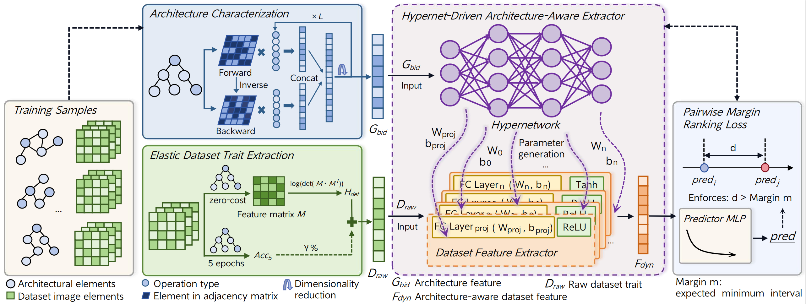

# ACDP: Architecture-Aware Cross-Dataset Performance Predictor for NAS



## Requirements

```
python == 3.8.20 
pytorch == 2.4.1
torchvision == 0.19.1
scipy == 1.10.1
nasbench == 1.0
nas_201_api == 2.1
```

## Dataset Preparation

This project uses two search spaces: NAS-Bench-201 and MobileNetV3.

**NAS-Bench-201**

Project: https://github.com/D-X-Y/NAS-Bench-201

**MobileNetV3**

Project: https://github.com/mit-han-lab/once-for-all

This project uses six datasets: CIFAR-10, CIFAR-100, MNIST, SVHN, FGVC-Aircraft and Oxford-IIIT Pets.

**CIFAR-10:** https://www.cs.toronto.edu/~kriz/cifar.html

**CIFAR-100:** https://www.cs.toronto.edu/~kriz/cifar.html

**MNIST:** http://yann.lecun.com/exdb/mnist/

**SVHN:** http://ufldl.stanford.edu/housenumbers/

**FGVC-Aircraft:** https://www.robots.ox.ac.uk/~vgg/data/fgvc-aircraft/

**Oxford-IIIT Pets:** https://www.robots.ox.ac.uk/~vgg/data/pets/

We provide two ways to access the experimental data:

### 1. Quick Start (Pre-processed Metrics)

